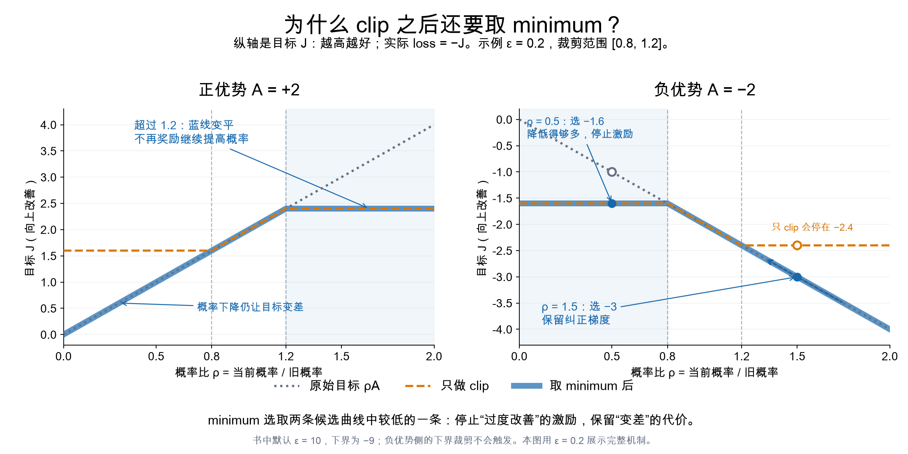
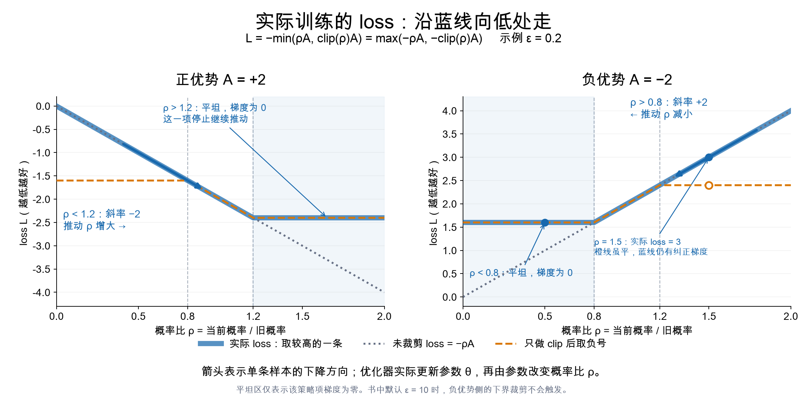

# 当前 GRPO 的单次更新、概率比与梯度

当前实现每轮用最新模型生成一批回答，再用这批回答完成一次优化器更新。`grpo_optimizer_step` 内部多次 `backward()` 累积梯度，参数在最后的 `optimizer.step()` 改变一次。

源码引用对应当前工作区，文中的数值例子已用 CPU 核对。

## 1. 一轮训练到底更新几次

沿用同一个例子，每轮抽取 2 道题，每题生成 4 条回答，共 8 条回答。每个微批处理 2 条回答，需要 4 次微批反传。

| 符号 | 含义 | 本例 |
|---|---|---|
| \(P\) | 每轮抽取的题目数 | 2 |
| \(G\) | 每题生成的回答数 | 4 |
| \(N=P G\) | 一轮 rollout 的回答总数 | 8 |
| \(B\) | 每个微批的回答数 | 2 |
| \(K=N/B\) | 一次更新需要累积的微批数 | 4 |

同一道题的 4 条回答连续排列。完整回答先得到 reward，组内比较后得到 advantage，再切成微批。即使一个回答组跨越多个微批，优势也已经使用完整组的信息算好。当前 [compute_group_normalized_rewards:7](../cs336_alignment/grpo_utils.py#L7) 根据完整回答的评分构造数值张量，随后将这些数值传给训练前向和 `backward()`。

这里的优势 \(A\) 在本批更新中固定，不沿采样、reward 或组内比较的过程对模型参数 \(\theta\) 求导。生成策略会影响采到什么回答，从而影响算出的 \(A\)，但本次反传只通过当前回答的 log-prob 回到参数。以后若复用同一批回答，\(A\) 也保持固定，下一轮重新生成回答后才可能重新算出不同的优势。

当前两轮执行过程如下。\(D_0,D_1\) 分别表示两轮生成并编码的回答批次，`old0`、`old1` 是各批更新前缓存的旧 log-prob。

```text
第 0 轮，参数 θ0
  抽 2 题 → 用 θ0 每题采样 4 条回答 → D0，共 8 条
      → 整组计算并固定 reward0 / A0 → 编码并缓存 old0 = log πθ0
      → zero_grad
      → 微批 1 backward ┐
      → 微批 2 backward │ 参数仍为 θ0，梯度持续累积
      → 微批 3 backward │
      → 微批 4 backward ┘
      → 一次梯度范数裁剪 → 一次 optimizer.step → θ1

第 1 轮，参数 θ1
  重新抽题 → 用 θ1 重新采样回答 → 新批次 D1
      → 重新计算并固定 reward1 / A1 → 缓存 old1 = log πθ1
      → zero_grad → 4 次微批 backward
      → 一次梯度范数裁剪 → 一次 optimizer.step → θ2
```

第一个微批反传后，第二个微批使用的仍是 θ0。`backward()` 把导数累加到参数的 `.grad`，不会执行参数更新。最后一次反传结束，才把完整批次的梯度交给优化器。当前 `num_steps` 因而表示优化器更新次数，同时也是新 rollout 批次的生成轮数。

对应源码入口是 [grpo_train_loop:169](../cs336_alignment/train_grpo.py#L169)。[外层循环:220](../cs336_alignment/train_grpo.py#L220) 每轮生成新回答，[调用优化器步:261](../cs336_alignment/train_grpo.py#L261) 只有一次。

优化器步的关键顺序可以压缩成下面几行，省略了切片和参数传递。

```python
# grpo_optimizer_step 的执行顺序
model.train()
optimizer.zero_grad(set_to_none=True)
for each_microbatch in the_same_rollout_batch:
    current_log_probs = get_response_log_probs(...)  # 保留计算图
    grpo_microbatch_train_step(...)                  # 内部 backward，累积梯度
grad_norm_before_clip = torch.nn.utils.clip_grad_norm_(...)
optimizer.step()                                     # 整批只在这里更新一次
```

这段是教学摘录，`each_microbatch` 省略了实际切片代码。完整实现见 [grpo_optimizer_step:74](../cs336_alignment/train_grpo.py#L74)，参数更新位于 [optimizer.step:159](../cs336_alignment/train_grpo.py#L159)。

## 2. 完整回答评分，逐 token 形成损失

一条完整回答得到一个 reward 和一个 advantage。例如同一题的 4 条回答会相互比较，产生 4 个优势值。传入优化器步时，优势形状为 `(N, 1)`。一个回答的优势沿 token 轴广播，该回答的所有有效 token 共用同一个 \(A_b\)。

模型对编码后的“提示+回答”评分，得到 `(N, L)` 的 `policy_log_probs`。每个位置保存“在该位置已有前缀下，模型给 labels 中那个 token 的对数概率”。GRPO 中被 `response_mask` 选中的回答 token 来自模型刚才采样的回答，reward 经组内比较得到优势 A，A 的正负决定要提高还是降低这些 token 的概率。SFT 的目标回答来自数据中的标准答案，两者使用 log-prob 的对象来源不同。

完整拼接并补齐的 token 序列为 `padded` 时，`input_ids = padded[:-1]`，`labels = padded[1:]`，因此输入位置 t 的输出对应下一 token 的标签。`labels` 里面也含 prompt 和 padding 对应的位置，`response_mask` 决定哪些位置计入回答损失。old 和 current 对同一组编码后的 `input_ids`、`labels` 评分，损失再用同一个 mask 选出回答位置，因此 token、前缀和位置能够逐项对应。编码见 [tokenize_prompt_and_output:18](../cs336_alignment/utils/tokenizer_utils.py#L18)，评分见 [get_response_log_probs:67](../cs336_alignment/utils/compute_entropy.py#L67)。

PG 是 **Policy Gradient**，表示通过策略梯度更新策略的一类方法，GRPO 也属于这一类。当前 `loss_type` 可以选择 `reinforce_with_baseline` 的 \(-A\log p\)，或 `grpo_clip` 的概率比裁剪目标。函数从中选择一种目标来训练。`no_baseline` 则将前者的权重换成原始 reward。分支见 [compute_policy_gradient_loss:128](../cs336_alignment/grpo_utils.py#L128)。

选择 `grpo_clip` 时，当前微批按以下顺序归约。

\[
\ell_{bt}=-\min\left(r_{bt}A_b,\;\operatorname{clamp}(r_{bt},1-\epsilon,1+\epsilon)A_b\right)
\]

\[
L_{\mathrm{micro}}
=\frac{1}{BK}\sum_{b=1}^{B}
\frac{\sum_t m_{bt}\ell_{bt}}{T_b},
\qquad T_b=\sum_t m_{bt}.
\]

\(r_{bt}\) 是同一 token 在当前策略与旧策略下的条件概率比，\(\epsilon\) 决定裁剪区间，\(m_{bt}\) 对应 `response_mask`。

先沿 token 轴取有效回答 token 的均值，得到 `(B,)` 的每条回答损失。再沿回答轴取均值，得到标量，最后除以累积步数 \(K\)。等大小微批累积后，就是对 \(N\) 条回答的平均损失求梯度。这里每条回答在 batch 均值中占相同权重，一条回答内部再按自身有效长度平均，并非把整批所有 token 混在一起求一次均值。

例如微批内两条回答的平均 token 损失为 `[3, 6]`，回答均值为 `4.5`，若 \(K=2\)，本次反传的标量是 `2.25`。只除以 \(K\) 不会消去 batch 维，`.mean()` 才把 `(B,)` 变成无参 `backward()` 需要的标量。

```python
# grpo_microbatch_train_step，loss 为 (B, L) 的逐 token 贡献
masked_loss = masked_mean(loss, mask=response_mask, dim=-1)  # (B,)
batched_masked_loss = masked_loss.mean() / gradient_accumulation_steps
batched_masked_loss.backward()                             # 梯度累加到参数
return batched_masked_loss.detach(), metadata              # detach 仅用于返回日志值
```

见 [masked_mean:165](../cs336_alignment/grpo_utils.py#L165)、[微批训练步:180](../cs336_alignment/grpo_utils.py#L180) 和 [mean/K:216](../cs336_alignment/grpo_utils.py#L216)。优化器步将各微批返回的 scaled loss 相加，作为本次完整 batch 的日志 loss。

## 3. old、current 和 reference 各负责什么

old/current 描述策略在一次更新中的角色，并不要求必须存在两份模型对象。

| 角色 | 本轮负责的工作 | 当前代码中的形态 |
|---|---|---|
| old policy | 为已采样回答提供固定的分母 log-prob | 更新前由同一个 `model` 评分，缓存无梯度 `(N, L)` 张量 |
| current policy | 用当前参数重新评分，构建可反传的分子 | 同一个 `model` 在微批训练前向中产生带计算图的 log-prob |
| reference policy | 为 KL 正则提供参照策略 | 本作业的这条训练路径省略 KL，没有这项评分 |

旧分数缓存之后，即使模型参数随后改变，缓存张量的数值也保持不变。这个固定分母已经足够支持当前的 ratio 计算，无须额外保存一份 old 模型。省略 reference KL 只去掉 KL 正则项，`grpo_clip` 仍然保留 current/old 的 ratio 和裁剪目标。

```python
# grpo_train_loop，参数更新前缓存固定分母
with _evaluation_context(model):
    old_log_probs = get_response_log_probs(
        model=model, input_ids=input_ids, labels=labels
    )["log_probs"]  # 同一 model 此刻扮演 old，张量不带梯度

# 随后交给 grpo_optimizer_step，重新前向获得带梯度的 current_log_probs
```

旧分数缓存位置见 [train_grpo.py:254](../cs336_alignment/train_grpo.py#L254)。课程对 KL 的取舍见主讲义 [第 20 页脚注 2](../cs336_spring2025_assignment5_alignment.pdf#page=20)、[第 24 页式 33](../cs336_spring2025_assignment5_alignment.pdf#page=24) 和 [第 34 页 On KL divergence](../cs336_spring2025_assignment5_alignment.pdf#page=34)。原论文中的 GRPO 同时讨论了固定 old policy 与 reference KL，这能帮助区分角色，但本文的当前实现以本地代码和讲义省略 KL 的目标为准。[DeepSeekMath §4.1](https://arxiv.org/html/2402.03300v3#S4.SS1)

## 4. 先比较两条目标分支，再确定梯度

每个 token 的概率比比较当前策略与固定旧策略给同一 token 的概率。令当前概率为 \(p\)，旧概率为 \(p_{\mathrm{old}}\)，当前 log-prob 为 \(x=\log p\)，则

\[
r=\frac{p}{p_{\mathrm{old}}}
=\exp(\log p-\log p_{\mathrm{old}}),
\qquad \frac{\partial r}{\partial x}=r.
\]

分别计算 \(u=rA\) 和 \(c=\operatorname{clamp}(r,1-\epsilon,1+\epsilon)A\)，先得到要最大化的 token 目标

\[
J=\min(u,c).
\]



图中蓝线为实际目标 \(J\)，越高越好。训练代码最小化 loss，因此取负后有

\[
L=-J=-\min(u,c)=\max(-u,-c).
\]



loss 图中蓝线越低越好，取两条负目标分支中较大者。两图曲线和当前代码默认的 [cliprange](../cs336_alignment/train_grpo.py#L86) 均采用 \(\epsilon=0.2\)，对应区间 \([0.8,1.2]\)。图页脚提及的 \(\epsilon=10\) 对应下界 \(-9\)，属于另一设定，本笔记统一采用 \(0.2\)。

先比较已经乘过 \(A\) 的两项，才能判断最终使用哪条分支。下表的导数针对单个 token 项，尚未乘 mask 和微批归约系数，\(A\) 与 \(p_{\mathrm{old}}\) 均固定。

| \(A\) | \(r\) | \(u=rA\) | \(c=\operatorname{clamp}(r)A\) | 选中的 loss \(-\min(u,c)\) | \(\partial L/\partial r\) | \(\partial L/\partial x=(\partial L/\partial r)r\) |
|---|---|---|---|---|---|---|
| 2 | 1.5 | 3 | 2.4 | \(-c=-2.4\) | 0 | 0 |
| 2 | 0.5 | 1 | 1.6 | \(-u=-1\) | -2 | -1 |
| -2 | 0.5 | -1 | -1.6 | \(-c=1.6\) | 0 | 0 |
| -2 | 1.5 | -3 | -2.4 | \(-u=3\) | 2 | 3 |

正优势时，概率已经提高过多，第一行选择固定的裁剪项，暂停继续鼓励这个方向。若正优势回答的概率反而降低，第二行仍取未裁剪项，梯度继续推动它回升。负优势时方向相反，第三行暂停继续鼓励已经过大的概率降低，第四行仍会惩罚负优势回答概率的上升。因此 ratio 越界本身不足以判断梯度是否为零，`clipped` 只在表中第一、第三行是 True。

第四行也说明了“梯度是几”需要指明自变量。取 \(p_{\mathrm{old}}=0.5\)、\(p=0.75\)，用单个可训练参数构造 logits \([\theta,0]\)，则 \(p=\operatorname{sigmoid}(\theta)\)、\(\theta=\log 3\)，并有

\[
\frac{\partial L}{\partial r}=2,
\qquad \frac{\partial L}{\partial x}=2\times1.5=3,
\qquad \frac{\partial x}{\partial\theta}=1-p=0.25,
\qquad \frac{\partial L}{\partial\theta}=3\times0.25=0.75.
\]

继续固定 \(p_{\mathrm{old}}=0.5\)、\(A=-2\)，用学习率 \(0.2\) 连续做两次 SGD，只考虑这个 token 项且不做梯度范数裁剪。两步中均取第四行的未裁剪分支，\(L=2r=4p\)，每步重新求当前梯度 \(\partial L/\partial\theta=4p(1-p)\)，再更新 \(\theta\leftarrow\theta-0.2\times4p(1-p)\)。

| 状态 | \(\theta\) | 当前概率 \(p\) | \(r=p/0.5\) | token loss \(L=2r\) |
|---|---|---|---|---|
| 初始 | 1.0986122887 | 0.7500000000 | 1.5000000000 | 3.0000000000 |
| 第一次更新后 | 0.9486122887 | 0.7208360124 | 1.4416720249 | 2.8833440498 |
| 第二次更新后 | 0.7876271242 | 0.6873216012 | 1.3746432024 | 2.7492864047 |

这组数字描述新旧策略已经存在差异、保持同一分母和优势继续更新的状态，将 ratio、log-prob、实际参数的导数连接到连续两次参数变化。

负优势分支中的平坦区也可以用 \(A=-1\) 看清。旧概率 \(0.2\) 时，下界对应概率 \(0.2\times0.8=0.16\)。若当前概率已经是 \(0.12\)，则 \(r=0.6\)，相对旧策略已经降低了 40%。此时 \(u=-0.6\)、\(c=-0.8\)，选中 loss 为常数 \(0.8\)，本批目标暂停继续鼓励更大的降低。下一批重新采样并刷新 old，若相应 token 又被采到且 \(A\) 仍为负，目标可以从新的基准继续鼓励降低概率。

平坦区的零梯度只针对这个 token 的损失贡献。整条回答、其他回答的 token 项仍会经过归约累加到共享参数，优化器已有的动量或 weight decay 也可能参与参数更新，因此参数甚至该 token 的概率仍可能继续变化。当前目标始终逐 token 做 ratio 和 clip，再聚合为回答 loss，整序列 ratio 则是各 token ratio 的乘积，两种裁剪目标不同。

裁剪发生在 loss 的目标分支中，step 后没有把参数或概率比投影回区间。当前优化器步也没有汇总或返回微批的 `clipped` 元数据，history 尚无 `clip_fraction` 统计。

源码对应以下计算。变量 `p` 保存 ratio，本文公式中的 \(p\) 表示 token 概率，二者通过 \(r=p/p_{\mathrm{old}}\) 对应。

```python
p = (policy_log_probs - old_log_probs).exp()  # 源码变量 p 保存逐 token ratio
u = p * advantages                          # 同一回答共享固定 A
c = torch.clamp(p, 1 - cliprange, 1 + cliprange) * advantages
loss = torch.where(u < c, u, c) * -1
metadata = {"clipped": c < u}               # 裁剪分支严格改变目标的标记
```

见 [ratio:113](../cs336_alignment/grpo_utils.py#L113)、[clamp:117](../cs336_alignment/grpo_utils.py#L117) 和 [clipped mask:124](../cs336_alignment/grpo_utils.py#L124)。

## 5. ratio 为 1 时，沿计算图回到实际参数

当前每批只更新一次。参数尚未改变时，old/current 对相同 token、前缀采用一致前向行为，ratio 就应当为 1 或接近 1。这时两条裁剪分支重合，loss 沿区间内的 ratio 分支求导。当前 old 使用 eval、current 使用 train，非零 Dropout 等行为差异可能破坏上述条件，具体模式在第 6 节说明。

令 \(x\) 为当前 log-prob，\(x_{\mathrm{old}}=\log p_{\mathrm{old}}\) 为固定旧 log-prob。未触发有效裁剪时

\[
L=-A\exp(x-x_{\mathrm{old}}),
\qquad \frac{\partial L}{\partial x}=-A\exp(x-x_{\mathrm{old}}).
\]

在 \(x=x_{\mathrm{old}}\) 处，ratio 的前向值为 1，loss 对 \(x\) 的导数为 \(-A\)，ratio 自身对 \(x\) 的导数为 1。延续 \(p=0.2\)、\(A=1\) 的首次更新例子，\(x=x_{\mathrm{old}}=\log(0.2)\)。将它连接到实际可训练参数，用 logits \([\theta,0]\) 构造二分类分布，令 \(\theta=\log(0.25)\)，则 \(p=\operatorname{sigmoid}(\theta)=0.2\)。

```text
前向   θ=ln(.25) → p=.2 → x=ln(.2) → z=x-x_old=0 → r=exp(z)=1 → L=-A*r=-1
反向     -.8    ←  -5  ←    -1    ←      -1     ←      -1    ←     1
                           固定 x_old=ln(.2)                  固定 A=1
```

反向一行是各节点的 \(\partial L/\partial\text{节点}\)，从最右侧的 \(\partial L/\partial L=1\) 开始，逐段乘上下表的局部导数。

| 节点 | 前向值 | 到下一个节点的局部导数 | 回传到该节点的梯度 |
|---|---|---|---|
| \(\theta\) | \(\log(0.25)\approx-1.3862944\) | \(\partial p/\partial\theta=p(1-p)=0.16\) | \(\partial L/\partial\theta=-5\times0.16=-0.8\) |
| \(p\) | 0.2 | \(\partial x/\partial p=1/p=5\) | \(\partial L/\partial p=-1\times5=-5\) |
| \(x\) | \(-1.6094379\) | \(\partial z/\partial x=1\) | \(\partial L/\partial x=-1\) |
| \(z=x-x_{\mathrm{old}}\) | 0 | \(\partial r/\partial z=\exp(z)=1\) | \(\partial L/\partial z=-1\) |
| \(r\) | 1 | \(\partial L/\partial r=-A=-1\) | \(\partial L/\partial r=-1\) |
| \(L\) | -1 | — | \(\partial L/\partial L=1\) |

SGD 用参数梯度更新参数。取学习率 \(0.1\)，同样只考虑这个 token 项且不做梯度范数裁剪，\(\theta'=\log(0.25)-0.1\times(-0.8)\)，更新后 \(p'\approx0.2131075922\)。正优势让该 token 概率提高。模型实际训练时，这条链延伸到所有参与前向的参数，并累积 mask、回答长度、batch 和 \(K\) 缩放后的各项梯度。

| 表达式，\(A=1\)、\(x=x_{\mathrm{old}}=\log(0.2)\) | loss 前向值 | 对 \(x\) 的导数 |
|---|---|---|
| PG 目标 \(-Ax\) | 1.6094379124341003 | -1 |
| ratio 目标 \(-A\exp(x-x_{\mathrm{old}})\)，\(x_{\mathrm{old}}\) 固定 | -1 | -1 |
| 直接构造常数 \(-A\times1\) | -1 | 没有到 \(x\) 的计算图路径 |
| 将 old 也写成 current，\(-A\exp(x-x)\) | -1 | 0，指数内的导数为 \(1-1\) |

常数版本若以 `torch.ones_like(x)` 构造且没有其他可求导输入，loss 的 `requires_grad=False`，单独 `backward()` 会报错。`exp(x-x)` 则会建图，但两条求导路径相互抵消。固定 old、固定 \(A\)，才能让 current 的 log-prob 路径承担策略更新。

表中两个可选训练目标在新旧评分一致的点，都有 \(\nabla_\theta L=-A\nabla_\theta\log\pi_\theta\)。相同 mask、归约和前向条件下，首次参数梯度一致，loss 数值无需相同。若同批复用使 current 离开固定 old，ratio 权重与裁剪分支就可能变化，后续更新一般不再等价。

## 6. eval、train 和 no_grad 分别控制什么

`eval()` 控制模块的前向行为，`no_grad()` 控制是否记录反向传播需要的计算图。它们可以独立组合。普通训练通常采用 `train` 并启用梯度，Dropout 在训练模式采样掩码，BatchNorm 使用批统计量并更新运行统计量。评估模式通常关闭 Dropout、让 BatchNorm 使用保存的统计量，但不会自动关闭 autograd。[PyTorch autograd 官方说明](https://docs.pytorch.org/docs/2.15/notes/autograd.html#evaluation-mode-nn-module-eval)

| 组合 | 模块采用的行为 | 是否记录可求导前向 | 在本问题中的用途 |
|---|---|---|---|
| `train()`，梯度开启 | 训练行为 | 是 | 当前优化器步的训练前向 |
| `eval()`，梯度开启 | 评估行为 | 是 | 可用于前向一致的训练设计，需相应调整当前 helper |
| `eval()` + `no_grad()` | 评估行为 | 否 | 当前生成和旧分数缓存 |
| `train()` + `no_grad()` | 训练行为 | 否 | 关闭求导，但仍可能保留 Dropout 随机性和模块状态更新 |

表中的“记录可求导前向”以相关输入或参数启用梯度为前提。独立 CPU 例子中，`nn.Linear.eval()` 的输出仍为 `requires_grad=True`，反传得到 `weight.grad`，同样的前向加上 `no_grad()` 后才不记录这条计算图。

当前 `_evaluation_context` 做了两件事，进入时调用 `eval()` 并开启 `no_grad()`，退出时逐个恢复所有子模块原有的 `training` 标志。即使原来部分子模块是 eval、其他模块是 train，也会恢复各自的状态。代码见 [_evaluation_context:40](../cs336_alignment/utils/log_utils.py#L40)。它适合不需要梯度的生成和 old 评分，不能包住 current 的训练前向，否则 current log-prob 没有用于策略更新的计算图。

若希望 old/current 前向一致，可以让训练评分也使用 eval 行为并保留梯度，或在 train 行为下关闭 Dropout 等随机差异。当前 helper 内部会调用 [model.train:121](../cs336_alignment/train_grpo.py#L121)，采用前一种方案需要相应调整 helper，外部的一次 `model.eval()` 会被覆盖。

当前 [generate_rollouts:23](../cs336_alignment/train_grpo.py#L23) 在 `_evaluation_context` 中给 `model.generate` 传入 `do_sample=True`，生成仍会采样。eval 模式下也可以采样，模块模式、梯度记录、下一 token 的选择方法各自独立。

## 7. 两种 clip 作用在不同位置

GRPO-Clip 的概率比裁剪改变逐 token 目标对 current log-prob 的导数。`clip_grad_norm_` 则在所有微批反传结束后，检查模型参数累积梯度的全局范数，必要时统一缩放这些梯度。前者属于损失函数，后者位于反传与参数更新之间。

即使 ratio 为 1、概率比裁剪没有改变目标，策略梯度仍可能很大，梯度范数裁剪仍可能有效。一个独立 CPU 例子中，参数梯度为 `5`，`max_norm=1` 时，`clip_grad_norm_` 返回的裁剪前范数是 `5`，裁剪后的梯度约为 `0.99999976`。因此当前返回字段 `grad_norm_before_clip` 记录的是裁剪前范数。

这也解释了更新顺序。先把 4 个微批的梯度累加完，再对完整梯度裁剪，最后执行一次 step。若每个微批分别裁剪，得到的累积向量一般不等于先累积再统一裁剪的结果。若把 step 移入微批循环，则后面的微批会在已更新参数上评分，更新次数和优化过程都会改变。

## 8. 将来复用同一批 rollout 时，哪些量固定

复用回答是后续可扩展的训练方式，当前尚未实现。扩展时，一批回答只生成一次，reward、advantage、old log-prob 也在这批回答开始更新前计算并固定。每次优化器更新都重新计算 current log-prob，清空上一更新的梯度，累积各微批反传，再做一次梯度范数裁剪和 step。

```text
为一批 D0 缓存 old0 / reward0 / advantage0，整个复用期间固定
    更新 1   zero_grad → current(θ0) → K 次 backward → clip → step → θ1
    更新 2   zero_grad → current(θ1) → K 次 backward → clip → step → θ2
    ……
下一批 D1 才重新生成，并建立自己的 old1 / reward1 / advantage1
```

第二次更新重新建立 current 的计算图，old0、reward0、advantage0 仍保持初始缓存值。每次更新在微批循环前清梯度，在循环结束后执行一次 step，保留第 1 节中的梯度累积边界。

增加复用层后，需明确 `num_steps` 是 rollout 轮数还是优化器更新总数，并分别记录两种计数。当前两者一一对应，扩展后会分开。原论文算法中的固定 rollout 多次更新内层循环可作为后续对照。[DeepSeekMath §4.1 算法](https://arxiv.org/html/2402.03300v3#S4.SS1)
